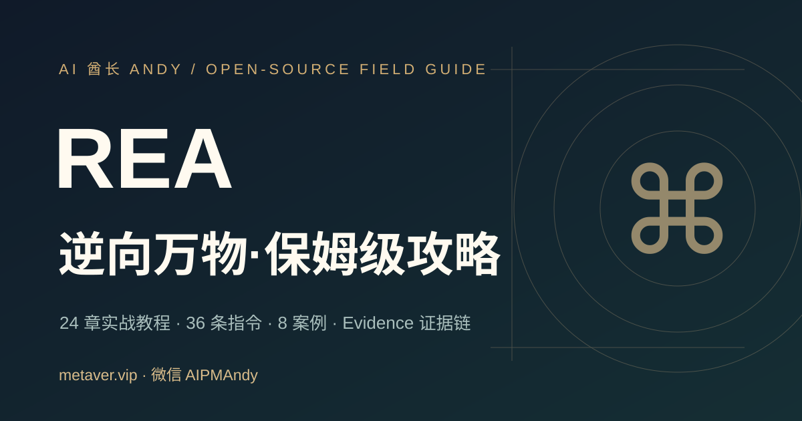

# REA 逆向万物 · 保姆级中文实战指南

> 从 Mac + Codex 安装到 Evidence 证据链、JavaScript/Electron、Web、Native、Android 等授权逆向工程。**独立中文教程，不属于 REA 官方项目。**

**作者：AI 酋长 Andy** · 微信 **`AIPMAndy`** · 官网 **https://metaver.vip/** · [AI / 职业服务](https://metaver.vip/services)



**GitHub（已正式公开）**：[AIPMAndy/rea-guide-cn](https://github.com/AIPMAndy/rea-guide-cn)（完整 V5 · 177 文件 · MIT 源码许可）  
**网站（GitHub Pages 待启用）**：`https://aipmandy.github.io/rea-guide-cn/`（尚未确认正式可访问）；官方 REA 项目：<https://github.com/morluto/rea>。

## 这份教程有什么

- **38 章完整内容**：安装、Agent/MCP、CLI、JS、Electron、Native、.NET、Android、Evidence、安全与重建。
- **64 条可复制任务指令**：用于 Codex/Claude Code/Cursor，默认先取证、再审批、再运行。
- **12 个分级案例**：1 个原创可执行 Node 样例，2 个上游官方演示，其余明确是教学实验计划。
- **30 天训练计划** 与 **12 项红队自检**，浏览器本地保存进度。
- **原创静态网站**：无需服务器和付费 API，GitHub Pages 即可发布。

## 一分钟理解 REA

REA 是面向 coding agent 的逆向工程编排工具，通过 MCP/CLI 连接静态与动态分析能力；**不能一键还原开发者原始源码**，也不能取代 Hopper / Ghidra / IDA 的商业或独立许可。

官方： [rea.tools](https://rea.tools/) · [morluto/rea](https://github.com/morluto/rea)

## Mac + Codex 安装路线

```bash
node --version
npm --version
npx rea-agents@latest setup
# 审阅将修改的 Agent 配置及备份，批准后重启 Codex
npx -y rea-agents@latest doctor --json
```

Node 版本门槛核查于 2026-10-21：Node 22.19+、24.11+ 或 26+（具体以你实际安装的 REA 版本为准）。[完整 Mac 安装指南](docs/INSTALL-MAC.md)。

静态 JS 试验：

```bash
cd examples/mini-app
node test.mjs
# 之后使用 REA 官方静态分析命令，对该目录绝对路径做分析
```

[Mini App 详细实验](examples/mini-app/README.md) · [REA CLI 速查](docs/CLI-CHEATSHEET.md)

## 38 章全目录

- [01｜认识 REA 与边界](guides/01-intro.md)
- [02｜Mac 从零安装](guides/02-install-mac.md)
- [03｜Windows 与 Linux](guides/03-install-cross-platform.md)
- [04｜Codex / Claude / Cursor 接入](guides/04-agents.md)
- [05｜首个十分钟逆向任务](guides/05-first-lab.md)
- [06｜REA CLI 常用命令](guides/06-cli.md)
- [07｜Evidence 证据链](guides/07-evidence.md)
- [08｜JavaScript / Electron 逆向](guides/08-javascript-electron.md)
- [09｜网页与运行观察](guides/09-website.md)
- [10｜原生程序与反编译器](guides/10-native.md)
- [11｜Windows Calculator 百分号案例](guides/11-calculator.md)
- [12｜Chrome 小恐龙加速规则案例](guides/12-dinosaur.md)
- [13｜Android APK 静态分析](guides/13-android.md)
- [14｜.NET 程序分析](guides/14-dotnet.md)
- [15｜Go / Rust / WASM / ELF](guides/15-formats.md)
- [16｜SQLite、JSON 与本地数据](guides/16-sqlite.md)
- [17｜网络抓包和动态行为](guides/17-captures.md)
- [18｜提示词设计与反证](guides/18-prompts.md)
- [19｜从观察到重建](guides/19-rebuild.md)
- [20｜安装故障排除](guides/20-troubleshoot.md)
- [21｜更新、迁移与卸载](guides/21-maintenance.md)
- [22｜许可、隐私与负责任使用](guides/22-legal.md)
- [23｜发布 Evidence 与社区协作](guides/23-contribute.md)
- [24｜一人开发者逆向工作流](guides/24-indie-workflow.md)

## V5 专项内容与可阅读网站

**不再只有摘要弹窗**：每一章都可通过 `pages/guides/XX-*.html` 完整阅读；文档、案例、模板全部有静态 HTML 页面，支持手机浏览，不需依赖 Markdown 渲染服务。

- **38 章**：新增桌面包、Go/Rust、GPU、GGUF/safetensors、IL2CPP、Godot、WASM、EVM、ADB、Flutter、固件、网络与崩溃记录、PyInstaller、受控进程捕获。
- **64 条可复制指令**：每条都包含授权范围、证据和反证。
- **12 个案例入口**：新增模型文件的原创合成样例及未实测研究方案；来源证据分级明确。
- **28 类 REA 官方能力覆盖矩阵**：与上游 README 对照，明确官方发布与当前 npm 可用不是一回事。
- **72 个完整 HTML 阅读页**（内容维护阶段，文件数随贡献扩展），并公开 [Benchmark 协议](docs/BENCHMARK.md)、[证据等级](docs/PROVENANCE.md)、[功能覆盖](docs/CAPABILITIES.md)。

**新增章节**：

- [25｜桌面安装目录的构成与分析入口](guides/25--.md)
- [26｜Go / Rust 产物元数据与供应链线索](guides/26-go-rust-.md)
- [27｜GPU 二进制、PTX 与设备兼容性](guides/27-gpu-code-objects.md)
- [28｜GGUF / safetensors 模型文件检查](guides/28-gguf-safetensors.md)
- [29｜Unity IL2CPP 元数据安全检查](guides/29-il2cpp-metadata.md)
- [30｜Godot PCK 资源结构与可复现导出](guides/30-godot-pck.md)
- [31｜WASM 模块导入导出与 ABI 理解](guides/31-wasm-artifact.md)
- [32｜EVM 字节码只读结构调查](guides/32-offline-evm.md)
- [33｜Android ADB 与设备取证范围](guides/33-android-devices.md)
- [34｜Flutter / Dart APK 构建来源观察](guides/34-flutter-metadata.md)
- [35｜固件镜像清单与安全抽取](guides/35-firmware.md)
- [36｜HAR / PCAP / 崩溃记录取证](guides/36-saved-captures.md)
- [37｜PyInstaller Python 打包程序静态识别](guides/37-pyinstaller.md)
- [38｜受控进程运行与 Evidence 对照实验](guides/38-process-behavior.md)

## 项目质量与安全

- [官方来源台账](docs/SOURCES.md) · [对抗式审核报告](docs/AUDIT.md) · [安全与许可](docs/SAFETY.md)
- [实验模板](templates/experiment.md) · [函数证据档案](templates/function-dossier.md) · [合法授权检查](templates/legal-review.md) · [原创重建规格](templates/rebuild-spec.md)
- [GitHub Pages 发布步骤](docs/DEPLOY.md)

```bash
python3 -m unittest discover -s tests -v
node examples/mini-app/test.mjs
python3 -m http.server 8000
```

这份教程的本地单元测试只验证**本站及原创示例**，不能证明作者已经在你的机器上真实运行 REA。官方案例按其原始出处引用；请勿将教学计划包装成已复现客户案例。

## 协议与贡献

- 原创网站、原创 JS 示例代码：MIT License（见 LICENSE）。
- 教程文字：CC BY 4.0（见 LICENSE-DOCS.md）。
- 第三方代码、软件、Logo、截图保留原有权利与许可证；不对它们二次授权。

欢迎用 PR 提交真实匿名化实验记录，必须给出环境、工具版本、来源、反证和授权边界。另见 [CONTRIBUTING.md](CONTRIBUTING.md)。

---

微信 **AIPMAndy** ｜ https://metaver.vip/ ｜ https://metaver.vip/services
